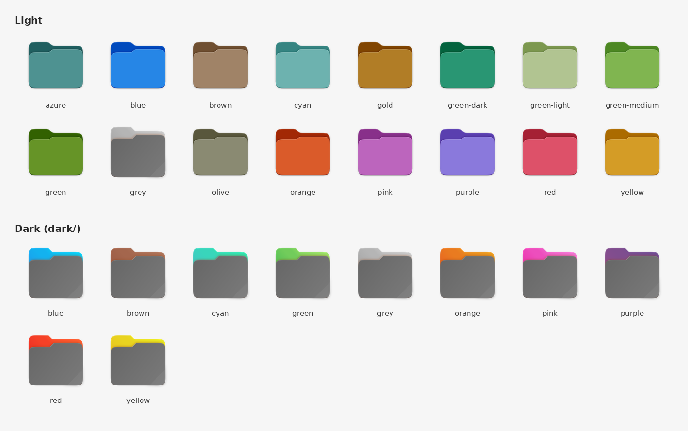

# Icons

A simple collection of colored folder icons for **Debian 13 (Trixie)**.

These are plain 512×512 PNG images, not a full icon theme. Use them to give individual folders a custom color in your file manager so they're easier to find at a glance.

## Available colors



| Light (`./`) | Dark (`./dark/`) |
|---|---|
| azure, blue, brown, cyan, gold, green, green-dark, green-light, green-medium, grey, olive, orange, pink, purple, red, yellow | blue, brown, cyan, green, grey, orange, pink, purple, red, yellow |

The files are named `folder-<color>.png`, for example `folder-blue.png` or `dark/folder-red.png`.

## Installation

Clone the repository into your home directory:

```bash
cd ~/ && git clone https://github.com/davidjimenez75/Icons.git
```

The icons will then be in `~/Icons`.

## Usage

### Files (Nautilus / GNOME)

1. Right-click a folder and select **Properties**.
2. Click the folder icon at the top of the dialog.
3. Browse to `~/Icons` and choose a `folder-<color>.png` file.

To go back to the default icon, open the same dialog and click **Revert** (or **Reset**).

### Command line

You can also set the icon from a terminal with `gio`:

```bash
gio set ~/Projects metadata::custom-icon file://$HOME/Icons/folder-blue.png
```

To remove it:

```bash
gio set -t unset ~/Projects metadata::custom-icon
```

## Credits

These icons are based on the work of the following projects:

- **Yaru**, the Ubuntu theme: <https://github.com/ubuntu/yaru>
- **Folder Color** by Marcos Alvarez Costales: <https://github.com/costales/folder-color>

All credit for the original artwork goes to their respective authors. Please refer to those repositories for their licensing terms.
